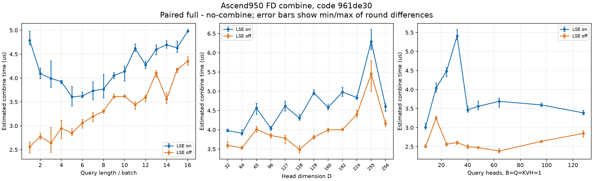

# FA Ascend950 FD combine 泛化测试（2026-10-13）

**已构造 97 条配置（92 种不同配置），全部通过实际 FD 路径与精度验证；其中 38 条完成同卡三轮性能采集。其余 59 条的性能待补测。**

本次针对提交 `961de30`，未修改算子实现。可靠计时表明 combine 耗时不随行数或 D 单调变化：D255 比 D256 慢；单 token、H32 开启 LSE 比 H40/H64 更慢；Q1→Q5 时行数增加但 LSE 开启耗时下降。应同时观察 **实际 partial 数、每核行轮数、D 对齐、DMA 调用数和 LSE 写回粒度**。

## 完成范围与采集限制

| 项目 | 状态 |
|---|---|
| 输入构造 | 98 条；host 判定 97 条 FD，1 条非 FD |
| 实际 FD 验证 | 97 条 × LSE 开/关 × 两种 native = 388 份 H2D tiling，全部匹配 host 调度 |
| 精度 | 97 条 × LSE 开/关通过；其中 93 条 BF16、4 条 FP16 |
| 三轮性能 | 38 条：Q 扫描 16、D 扫描 12、H 扫描 9、单 batch 自动 splits 1 |
| 待补性能 | 59 条：其余 split、KV 长度、batch、KVH、长短分布、变长 Q 和 FP16 等扫描 |

共享机器上其他任务多次进入同一卡。采集遇到并发占用时整次排除；后续 NPU 3 的完整矩阵尝试也未获得可用配对数据。最终表格**只使用物理 NPU 5 的上述 38 条三轮数据**，没有把不同卡或单边未配对的时间拼入均值。已停止本次未完成的采集进程，保留可恢复脚本、原始数据及排除记录；没有终止其他用户的任务。

实验根目录（下文 `$ART`）：

```text
/home/lilongwei_hw/flash-attention-npu-build-logs/fa-fd-combine-generalization-20261013-lc1b1pff
```

`pending-timings.json` 列出准确的 59 条待补项及缺失的轮次/版本。`chunk-02` 有单边采集，尚无三轮完整配对，不属于下表。`npu3-complete-matrix` 仅保留尝试记录，也不属于下表。

## 输入与精度

完整定义见 [97 条输入矩阵](fa_fd_combine_generalization_cases_20261013.json)。覆盖 Q=1–16、D=32–256（含 65/127/129/255）、H=8–128、splits=0/2/3/4/6/8/12/16/20/24/28、KV=1024–32768（含非整页尾块）、B=1–8、KVH=1/2/4/8、长短 KV、变长 Q、BF16/FP16，以及 LSE 开/关。

97 条中保留两组重复锚点，实际为 92 种不同配置：`q_14/split_mixed_16/skew_2048`；`heads_64/split_single_16/kv_8192/kvheads_1`。不能把它们计为独立 shape。

额外 B9/Q4/H8/KVH1/D128/KV8192 输入产生 9 个基础任务，超过 28 AIC 上 FD 的 `floor((3×28−1)/10)=8` 个任务上限。host 明确选择非 FD，已排除，见 `excluded-cases.json`。指定 num_splits>1 并不保证进入 FD。

采用 seed=1 的随机 Q/K/V，独立 CPU FP32 attention 参考按各 KV head 分组计算。O 阈值：BF16 沿用 atol=0.03、rtol=0.02；FP16 使用 atol=0.005、rtol=0.005。LSE 沿用 atol=2e-4、rtol=2e-5。BF16 最大 O 绝对误差 0.019958，最大 LSE 误差 1.1444e-5；FP16 分别为 0.002292、2.0981e-5。初次 FP16 验证使用公共阈值，随后复核保存的逐组最大绝对误差，O 均小于 0.005、LSE 均小于 2e-4，不依赖 rtol 即满足更严格 FP16 阈值，证据见 `fp16-strict-check.json`。所有输入的 LSE 开关 O 输出逐位相同。

full/no-combine 两种隔离 native 的真实 FD tiling 各捕获 194 份，全部匹配当前源码编译的 host probe。关闭 combine 的输出无效，不读取，不用于精度判断。

## 性能口径

- NPU 5，Ascend950PR，28 AIC / 最多 56 AIV。复用与当前 35 个相关源码文件逐文件哈希一致的 full native；no-combine 的源码只屏蔽 `combine(params)`，保留 partial 写出和原 `SyncAll`。没有重装扩展。
- 每条配置、LSE 模式、版本，每轮预热 50 次、测量 100 次。三轮顺序为 full→no-combine、no-combine→full、full→no-combine。
- 38 条 × 2 种 LSE × 2 版本 × 3 轮 × 100 = **45,600 个有效 Task Duration 样本**；加预热为 68,400 次调用。源数据来自 `chunk-00`、`chunk-01` 的 12 份已接受采集。
- 检查输入/native 哈希、FAInfer 数量及 AIC/AIV launch 数；采集前后检查空闲、期间定期检查进程。出现并发占用则整次排除。对所有版本统一应用 max > 3×median 的长尾规则，触发时整次重采；不按快慢挑选单个样本。最终这 12 份采集的最大 max/median 为 1.29。
- 每轮 `combine估算 = full平均Task Duration − 对应no-combine平均Task Duration`，再对三轮求均值。combine 集成在 FAInfer 内，**这是增量估算，不是独立 kernel 计时**；含尾部/代码生成差异，不包含保留在两种版本中的完整 SyncAll 成本，也不是端到端时延。
- 重复相同输入，属于 warm-cache 测量。三轮最小/最大值反映本次波动，不是置信区间。

证据：`builds.json`、`provenance.json`、`full-vs-no-combine.patch`、`validation-full.json/.pt`、`full-runtime-schedules.json`、`no-combine-runtime-schedules.json`、`summary.json/.csv`、`runs.json`、`kernel-durations.csv`。后两个文件保留单边未配对采集；分析时严格筛选三轮完整配对的 case，见 `summarize_fd_combine_generalization.py --allow-incomplete`。

## 实测曲线



蓝色为 LSE 开，橙色为 LSE 关；误差棒为三轮差值的 min/max。D 按离散测试值等间距排列，以看清 64/65、127/128/129、255/256 的相邻变化。

## 1. Q 增加时，先看行块粒度和分配变化

B4/H8/D128/KVH1，KV=[8192,2048,2048,2048]，splits=16；实际 partials 始终是 [16,4,4,4]。

| case | 实际 partials | 总 O 读取 KiB | 最大核 O KiB 开/关 | 调度 开/关 | 行轮数 开/关 | O DMA 调用 开/关 | combine 开 µs | combine 关 µs |
|---|---|---:|---|---|---|---|---:|---:|
| q_1 | 16,4×3 | 112 | 8/8 | 均衡/原 | 1/1 | 1/1 | 4.788 | 2.561 |
| q_2 | 16,4×3 | 224 | 8/16 | 均衡/原 | 1/1 | 1/1 | 4.092 | 2.772 |
| q_3 | 16,4×3 | 336 | 8/16 | 均衡/原 | 1/1 | 1/1 | 3.992 | 2.641 |
| q_4 | 16,4×3 | 448 | 8/24 | 均衡/原 | 1/1 | 1/1 | 3.924 | 2.947 |
| q_5 | 16,4×3 | 560 | 16/24 | 均衡/原 | 1/1 | 1/1 | 3.605 | 2.849 |
| q_6 | 16,4×3 | 672 | 16/32 | 均衡/原 | 1/1 | 1/1 | 3.625 | 3.057 |
| q_7 | 16,4×3 | 784 | 16/32 | 均衡/原 | 1/1 | 1/1 | 3.733 | 3.195 |
| q_8 | 16,4×3 | 896 | 16/16 | 均衡/均衡 | 1/1 | 1/1 | 3.767 | 3.307 |
| q_9 | 16,4×3 | 1008 | 24/24 | 均衡/均衡 | 2/2 | 2/2 | 4.053 | 3.610 |
| q_10 | 16,4×3 | 1120 | 24/24 | 均衡/均衡 | 2/2 | 2/2 | 4.138 | 3.616 |
| q_11 | 16,4×3 | 1232 | 24/24 | 均衡/均衡 | 2/2 | 2/2 | 4.618 | 3.441 |
| q_12 | 16,4×3 | 1344 | 24/24 | 均衡/均衡 | 2/2 | 2/2 | 4.276 | 3.593 |
| q_13 | 16,4×3 | 1456 | 32/32 | 均衡/均衡 | 2/2 | 2/2 | 4.597 | 4.103 |
| q_14 | 16,4×3 | 1568 | 32/32 | 均衡/均衡 | 2/2 | 2/2 | 4.696 | 3.559 |
| q_15 | 16,4×3 | 1680 | 32/32 | 均衡/均衡 | 2/2 | 2/2 | 4.631 | 4.177 |
| q_16 | 16,4×3 | 1792 | 32/32 | 均衡/均衡 | 2/2 | 2/2 | 4.982 | 4.352 |

Q1→Q5：总 partial O 读取量由 112 增至 560 KiB，开启 LSE 的耗时却 **4.788→3.605 µs**。有效 AIV 由 32 增至 44；Q1 每核只有一行，Q5 的行块为 2/5 行。更细碎的任务与小块 LSE 写回不能仅用总字节量衡量。

Q8→Q16：开启 LSE 的耗时 **3.767→4.982 µs**，此区间整体增长，但仍有局部回落。Q8 后辅助任务逐渐需要每核两轮；source subblock 边界、整数分核和输出跨 head 的写回边界都会改变执行形态。

关闭 LSE 在 Q1–7 使用原调度，Q8 起使用均衡调度。因此两个 LSE 模式的差值有时还包含分配方式变化，不能全部记作 Log 或最终 LSE store 耗时。

## 2. 非对齐 D 的 DMA 路径存在可见代价

B7/Q16/H4/KVH1，KV=[8192,1024×6]，splits=16；实际 partials=[16,2×6]。

| case | 实际 partials | 总 O 读取 KiB | 最大核 O KiB 开/关 | 调度 开/关 | 行轮数 开/关 | O DMA 调用 开/关 | combine 开 µs | combine 关 µs |
|---|---|---:|---|---|---|---|---:|---:|
| d_32 | 16,2×6 | 224 | 16/16 | 原/原 | 1/1 | 1/1 | 3.977 | 3.595 |
| d_64 | 16,2×6 | 448 | 32/32 | 原/原 | 1/1 | 1/1 | 3.910 | 3.531 |
| d_65 | 16,2×6 | 455 | 8.125/8.125 | 均衡/均衡 | 2/2 | 16/16 | 4.567 | 4.011 |
| d_96 | 16,2×6 | 672 | 12/12 | 均衡/均衡 | 2/2 | 2/2 | 4.040 | 3.854 |
| d_127 | 16,2×6 | 889 | 15.875/15.875 | 均衡/均衡 | 2/2 | 16/16 | 4.616 | 3.782 |
| d_128 | 16,2×6 | 896 | 16/16 | 均衡/均衡 | 2/2 | 2/2 | 4.304 | 3.489 |
| d_129 | 16,2×6 | 903 | 16.125/16.125 | 均衡/均衡 | 2/2 | 16/16 | 4.957 | 3.805 |
| d_160 | 16,2×6 | 1120 | 20/20 | 均衡/均衡 | 2/2 | 2/2 | 4.579 | 3.998 |
| d_192 | 16,2×6 | 1344 | 24/24 | 均衡/均衡 | 2/2 | 2/2 | 4.981 | 4.004 |
| d_224 | 16,2×6 | 1568 | 28/28 | 均衡/均衡 | 2/2 | 2/2 | 4.835 | 4.403 |
| d_255 | 16,2×6 | 1785 | 31.875/31.875 | 均衡/均衡 | 2/2 | 16/16 | 6.289 | 5.452 |
| d_256 | 16,2×6 | 1792 | 32/32 | 均衡/均衡 | 2/2 | 2/2 | 4.607 | 4.163 |

最清楚的相邻对照是 D255/D256：

| 项目 | D255 | D256 |
|---|---:|---:|
| partial O 总读取 | 1785 KiB | 1792 KiB |
| 每轮最多逻辑搬运批数 | 1 | 1 |
| 最大单核 O DMA 调用数，含所有行轮次 | 16 | 2 |
| combine / LSE开 | 6.289 µs | 4.607 µs |
| combine / LSE关 | 5.452 µs | 4.163 µs |

D255 开启 LSE 比 D256 慢 **36.5%**，关闭时慢 **31.0%**。两者三轮范围不重叠；不能用少了一个维度解释为更少的工作。

源码中 `LoadPartials()` 在 D%8==0 时使用一条跨 split 的 strided DataCopyPad；D%8!=0 时需要每个 split 单独搬运并填充 UB 行。因此“一批 partial O”可能包含 16 次 DMA 调用。该分支差异与实测相符，但本轮没有为其做单独实现 A/B，不能把全部差值精确归给这一项。

D64→D65 还同时跨过小负载回退阈值和 64 元素 VF 列循环边界。D128→D129 增加了一段 VF 列循环，且进入逐 split padding DMA 分支。D 的影响本来就具有离散拐点。

## 3. 单 token、多 head：H32 的 LSE 开启路径有峰值

B=Q=KVH=1，D128，KV8192，splits16，均使用原调度。

| case | 实际 partials | 总 O 读取 KiB | 最大核 O KiB 开/关 | 调度 开/关 | 行轮数 开/关 | O DMA 调用 开/关 | combine 开 µs | combine 关 µs |
|---|---|---:|---|---|---|---|---:|---:|
| heads_8 | 16 | 64 | 8/8 | 原/原 | 1/1 | 1/1 | 3.012 | 2.503 |
| heads_16 | 16 | 128 | 8/8 | 原/原 | 1/1 | 1/1 | 4.041 | 3.242 |
| heads_24 | 16 | 192 | 8/8 | 原/原 | 1/1 | 1/1 | 4.485 | 2.564 |
| heads_32 | 16 | 256 | 8/8 | 原/原 | 1/1 | 1/1 | 5.408 | 2.607 |
| heads_40 | 16 | 320 | 16/16 | 原/原 | 1/1 | 1/1 | 3.465 | 2.498 |
| heads_48 | 16 | 384 | 16/16 | 原/原 | 1/1 | 1/1 | 3.558 | 2.476 |
| heads_64 | 16 | 512 | 16/16 | 原/原 | 1/1 | 1/1 | 3.690 | 2.383 |
| heads_96 | 16 | 768 | 24/24 | 原/原 | 1/1 | 1/1 | 3.596 | 2.639 |
| heads_128 | 16 | 1024 | 32/32 | 原/原 | 1/1 | 1/1 | 3.386 | 2.847 |

H32→H40：行块从 1 行增至 2 行，有效 AIV 从 32 减至 20。开启 LSE 的耗时 **5.408→3.465 µs**；关闭时仅 **2.607→2.498 µs**。H128 开启 LSE 也只有 3.386 µs，低于 H32。

更少 AIV、较大的 LSE 写回块在这里更快，与多核向邻近地址发出小块 LSE 写回的开销相符。本次没有逐核 MTE3/地址冲突计数，尚不能确诊硬件 bank 或 cache-line 冲突。

H16 关闭 LSE 也有局部峰值；仅靠本轮的调度计数还不能解释所有拐点，不能把所有异常都归因于 LSE。

## 4. 自动 split 的一个完成对照

`split_single_0` 与 `heads_64` 的输入完全相同，仅 num_splits 为 0/16。自动模式实际是 28 partials，显式模式实际为 16。

| case | 实际 partials | 总 O 读取 KiB | 最大核 O KiB 开/关 | 调度 开/关 | 行轮数 开/关 | O DMA 调用 开/关 | combine 开 µs | combine 关 µs |
|---|---|---:|---|---|---|---|---:|---:|
| split_single_0 | 28 | 896 | 28/28 | 原/原 | 1/1 | 1/1 | 4.151 | 3.211 |
| heads_64 | 16 | 512 | 16/16 | 原/原 | 1/1 | 1/1 | 3.690 | 2.383 |

这个单 batch 对照说明应使用实际 partial 数分析；多 batch 时请求值还会被合并调度改变。完整 split 扫描尚待补测，本轮不据此宣称其总体单调规律。

## 对后续优化的判断

本轮已计时的 38 条配置中，所有行轮次都只有 **一批** partial O。因此，这批数据不支持把“批内双缓冲”当作首选。D255 等场景有多条 DMA，但它们属于同一逻辑批，且已经一起排队后等待，不能直接套用多批 ping-pong 的收益假设。

更值得下一轮做 A/B 的方向是：非对齐 D 的逐 split DMA；极小行块的 LSE 写回粒度；整数分核造成的多轮执行。它们仍是候选方向，本次没有修改 kernel 或声称已经获得优化收益。

从已验证的 97 条**调度**看，96 条配置两种 LSE 模式下都只有单轮一批，`skew_4096` 才有单轮两批；另有 split_mixed_2、skew_256、skew_1024、varq_tails 等每核四轮的配置。这是 host 推导并经运行时 metadata 核对的工作量，**它们的耗时尚未完成测量**，不能当作性能结论。

## 完整三轮范围

| case | LSE开 均值 [min,max] µs | LSE关 均值 [min,max] µs | full开 µs | full关 µs |
|---|---:|---:|---:|---:|
| q_1 | 4.788 [4.692,4.977] | 2.561 [2.433,2.661] | 14.308 | 12.077 |
| q_2 | 4.092 [3.985,4.206] | 2.772 [2.715,2.842] | 13.624 | 12.294 |
| q_3 | 3.992 [3.805,4.356] | 2.641 [2.441,2.964] | 13.648 | 12.292 |
| q_4 | 3.924 [3.879,3.951] | 2.947 [2.733,3.116] | 13.859 | 12.546 |
| q_5 | 3.605 [3.414,3.819] | 2.849 [2.795,2.934] | 13.432 | 12.572 |
| q_6 | 3.625 [3.582,3.706] | 3.057 [2.951,3.130] | 13.548 | 12.874 |
| q_7 | 3.733 [3.545,3.920] | 3.195 [3.086,3.276] | 13.762 | 13.131 |
| q_8 | 3.767 [3.585,4.072] | 3.307 [3.265,3.339] | 14.038 | 13.583 |
| q_9 | 4.053 [3.986,4.113] | 3.610 [3.578,3.668] | 14.968 | 14.477 |
| q_10 | 4.138 [3.937,4.248] | 3.616 [3.602,3.644] | 15.165 | 14.643 |
| q_11 | 4.618 [4.558,4.710] | 3.441 [3.340,3.503] | 16.001 | 14.862 |
| q_12 | 4.276 [4.203,4.349] | 3.593 [3.511,3.643] | 15.848 | 15.236 |
| q_13 | 4.597 [4.485,4.691] | 4.103 [4.011,4.158] | 16.570 | 16.072 |
| q_14 | 4.696 [4.624,4.779] | 3.559 [3.463,3.690] | 16.808 | 15.706 |
| q_15 | 4.631 [4.537,4.774] | 4.177 [4.116,4.208] | 17.106 | 16.589 |
| q_16 | 4.982 [4.964,5.013] | 4.352 [4.271,4.446] | 17.566 | 16.973 |
| d_32 | 3.977 [3.949,4.018] | 3.595 [3.539,3.690] | 13.654 | 13.165 |
| d_64 | 3.910 [3.867,3.996] | 3.531 [3.502,3.574] | 13.721 | 13.320 |
| d_65 | 4.567 [4.397,4.685] | 4.011 [3.935,4.085] | 14.591 | 14.052 |
| d_96 | 4.040 [3.982,4.086] | 3.854 [3.781,3.903] | 14.158 | 13.869 |
| d_127 | 4.616 [4.483,4.737] | 3.782 [3.636,3.857] | 15.208 | 14.383 |
| d_128 | 4.304 [4.245,4.403] | 3.489 [3.401,3.583] | 14.788 | 13.939 |
| d_129 | 4.957 [4.905,5.041] | 3.805 [3.761,3.862] | 16.607 | 15.540 |
| d_160 | 4.579 [4.524,4.652] | 3.998 [3.944,4.044] | 16.515 | 15.927 |
| d_192 | 4.981 [4.866,5.103] | 4.004 [3.979,4.043] | 16.850 | 15.925 |
| d_224 | 4.835 [4.791,4.886] | 4.403 [4.321,4.508] | 17.395 | 17.065 |
| d_255 | 6.289 [6.081,6.600] | 5.452 [4.994,5.796] | 19.829 | 19.076 |
| d_256 | 4.607 [4.475,4.676] | 4.163 [4.086,4.239] | 17.549 | 16.976 |
| heads_8 | 3.012 [2.957,3.106] | 2.503 [2.469,2.552] | 10.900 | 10.419 |
| heads_16 | 4.041 [3.933,4.170] | 3.242 [3.212,3.298] | 11.930 | 11.193 |
| heads_24 | 4.485 [4.339,4.577] | 2.564 [2.515,2.596] | 12.482 | 10.538 |
| heads_32 | 5.408 [5.309,5.575] | 2.607 [2.561,2.643] | 13.395 | 10.588 |
| heads_40 | 3.465 [3.407,3.554] | 2.498 [2.442,2.550] | 11.563 | 10.591 |
| heads_48 | 3.558 [3.472,3.690] | 2.476 [2.455,2.494] | 11.738 | 10.652 |
| heads_64 | 3.690 [3.537,3.777] | 2.383 [2.335,2.446] | 12.000 | 10.743 |
| heads_96 | 3.596 [3.557,3.648] | 2.639 [2.605,2.661] | 13.119 | 12.148 |
| heads_128 | 3.386 [3.335,3.449] | 2.847 [2.755,2.912] | 13.732 | 13.209 |
| split_single_0 | 4.151 [3.940,4.330] | 3.211 [3.080,3.373] | 13.409 | 12.489 |

## 复现和续采

构造输入及预测调度：

```bash
cd /home/lilongwei_hw/flash-attention-npu
g++ -std=c++17 -O2 -shared -fPIC tests/fd_combine_tiling_probe.cpp -o /tmp/fd-combine-probe.so
python tests/plan_fd_combine_generalization.py --probe /tmp/fd-combine-probe.so --output-dir /tmp/fd-combine-plans
```

设置 ART 为上述实验根目录，NPU_ID 为可用卡号，使用相同 native 做单次采集：

```bash
source /home/lilongwei_hw/Ascend/cann-9.2.0-beta.2/set_env.sh
export ASCEND_RT_VISIBLE_DEVICES="$NPU_ID"
export PYTHONPATH=/home/lilongwei_hw/flash-attention-npu
msprof --ai-core=off --task-time=on --ascendcl=off --output="$ART/repro-full"   /home/lilongwei_hw/miniconda3/bin/python -u tests/profile_fd_combine_sweep.py   --cases-json tests/fa_fd_combine_generalization_cases_20261013.json   --manifest "$ART/builds.json" --variant full --mode profile   --warmup 50 --iterations 100 --output "$ART/repro-full.pt"
```

no-combine 使用 `--variant no-combine` 及新的输出目录。不能直接省略 manifest：安装环境仍为旧扩展，本次测的是隔离目录中与 961de30 匹配的版本。

分组采集脚本在 `$ART/chunk-*/run_profiles.py`，会从各自 runs.json 跳过已完成的轮次/版本。`chunk-02` 的 case 与已完成分组不重复，可以续采；`chunk-03` 已准备好最后 29 条。待 NPU 5 稳定空闲后，source CANN 环境并执行 `$ART/resume_remaining.py` 可续采这两组并合并已接受数据；该脚本尚未启动。保持同卡、同输入和完整 full/no-combine 配对；不要混入未完成单边数据。

从已有原始数据重新汇总、绘图：

```bash
/home/lilongwei_hw/miniconda3/bin/python tests/summarize_fd_combine_generalization.py   --artifacts "$ART" --allow-incomplete   --figure tests/fa_fd_combine_generalization_20261013.png
```

不加 `--allow-incomplete` 时，任何配置缺少三轮配对都会报错。脚本仅在显式启用时输出完成的配置，并把其他配置列入 pending-timings.json。
