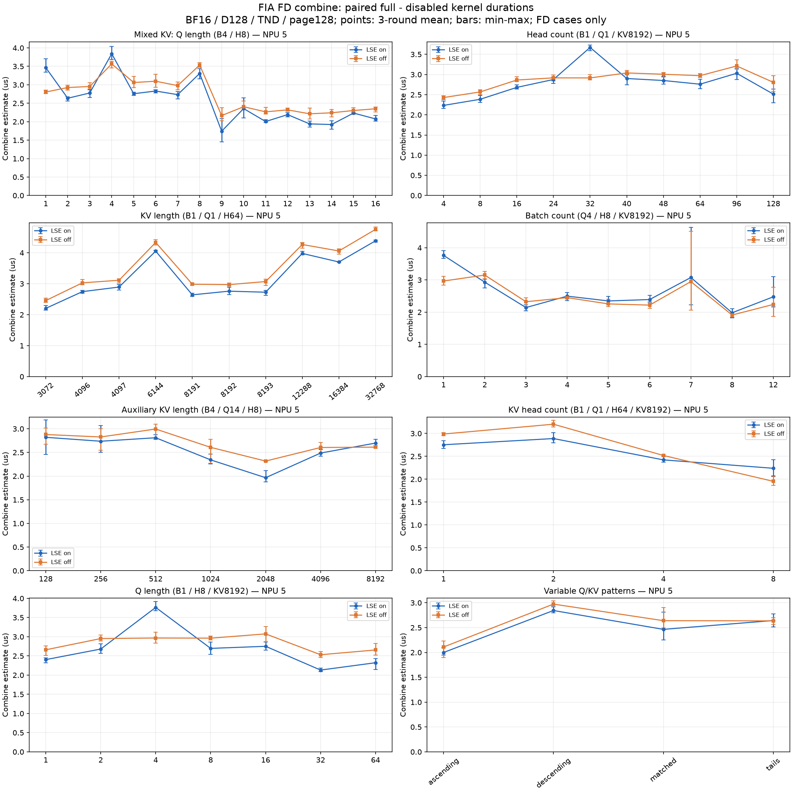

# FIA FD combine 泛化测试：实际分块与耗时变化（2026-10-13）

## 结果

构造 **68 组不同输入，62 组实际进入 FIA FD，6 组未进入 FD**。62 组 × LSE 开关均完成 **三轮完整/屏蔽 combine 配对采集**，共 **79,200 个有效 kernel Task Duration 样本（含 4 个公共基准输入的重复三轮采集）**。本轮全部为 BF16、D128、TND、page size 128、非 causal、无 mask；覆盖 Q、head 数、KV 长度、batch、辅助序列长度、KV head 数及变长 Q/KV。

combine 差分均值范围为 **1.742–4.755 µs**。曲线明显分段，不能根据 Q、KV 长度或总读取量单独线性外推。更有解释力的是 **实际 split 数、每个 AIV 的行块轮数、参与核数以及输出写回方式**。



图中横轴使用等间距测试点；纵轴单位为 µs。点为三轮配对差分均值，误差条为三轮最小/最大值，**不是置信区间**；不含未进入 FD 的点。原始数值及每轮完整/屏蔽耗时见 [summary.csv](../../flash-attention-npu-build-logs/fia-fd-combine-generalization-20261013-9k_p1850/summary.csv) 和 [summary.json](../../flash-attention-npu-build-logs/fia-fd-combine-generalization-20261013-9k_p1850/summary.json)。

## 计时边界和验证

- 普通 `msprof --ai-core=off --task-time=on --ascendcl=off`，提取 `FusedInferAttentionScore` 主 kernel 的 `Task Duration(us)`。每组预热 50 次，随后测量 100 次；三轮顺序为完整/屏蔽、屏蔽/完整、完整/屏蔽。
- 每轮先求 `mean(full) - mean(no-combine)`，然后对三轮差分取平均。屏蔽版本只移除 `vecFdBlock.FlashDecode(fdParams)` 调用，保留 partial 计算与写回、buffer/event 设置、`SyncAll` 和事件释放。**这是主 kernel 尾部增量估计，不是独立 combine kernel 的直接计时**，不含主机开销，可能受编译代码布局、同步等待和主 kernel 状态影响。
- 性能全部来自同一物理 **NPU 5，Ascend950PR，28 AIC / 56 AIV**；精度和路由诊断在 NPU 2 完成。性能进程关闭 plog。记录测量前后和期间的设备进程；实际测量窗口监测到外部进程则整次采集丢弃。benchmark 内部在实际调用前后检查占用，采集器在期间持续监控；profiler 导出阶段的占用不作为算子测量争用。保留 NPU 5 首批完成的 36 组，补测其余 26 组并重复 4 个公共基准输入；其他卡的未完成尝试独立归档，不混入本报告。前期采集曾对整个 profiler 生命周期检查占用，后续将检查精确到 benchmark 实际调用前后和期间；已排除的尝试没有重新纳入。
- 单组最大 Task Duration 超过中位数 3 倍时，整次采集排除并重跑，不逐点删样本。本轮有效数据最大比值为 1.20。共 24 次有效采集；带排除记录的尝试目录 11 个，包括未启动测量的等待记录。不同轮次的差分仍有波动，因此对小于误差条的差异不作确定归因。
- 62 组 × LSE 开关的实际 tiling、FD task、每核 `mStart/mLen`、split 数，在完整/屏蔽包之间逐项相同；与内置完整 FIA 的调度也相同。plog 确认加载各自隔离二进制，两个二进制 SHA256 不同。
- 内置完整 FIA 的 68 组以及隔离完整 FIA 的 62 组全部通过独立 CPU FP32 attention 参考；O 容差 `atol=0.03, rtol=0.02`，LSE 容差 `atol=2e-4, rtol=2e-5`。最大 O 绝对误差 **0.0200247765**，最大 LSE 绝对误差 **7.6293945e-6**。LSE 开关所得 O 逐位一致，隔离完整包与内置包输出逐位一致。屏蔽版本不读取输出。
- 复用此前隔离构建的两个 BF16 FD 包；本轮没有修改或安装算子实现。核对 `ops-transformer` 当前 FIA 与 attention/common 下 **298 个源码文件**与完整包的构建源码一致。算子仓库基线 `20e0b2ba62a31dececaa1d12eb79d59501446d24`；测试仓库起点 `2348a54`。CANN `cann-9.2.0-beta.2`，Python 3.12，torch / torch_npu 2.12。

## 主要规律

### 1. 实际 split 数决定了很多台阶，KV 长度并不与 combine 耗时单调对应

固定 B1 / Q1 / H64 / KVH1，`KV=6144` 时实际 split=24，`KV=8192` 时为 16；每核均处理 2 行、1 个行块，partial O 总读取量从 768 KiB 降为 512 KiB。LSE 开启时 **4.052 → 2.759 µs，下降 31.9%**；关闭时 **4.333 → 2.971 µs**。更长的 KV 在主阶段更费时，但不意味着 combine 更费时。

`KV=4096 / 8191 / 8192` 的 combine 调度都是 16 splits × 每核 2 行、32 个有效 AIV、512 KiB partial O，LSE 开启差分分别为 **2.744 / 2.641 / 2.759 µs**，处于相近水平。尾长跨边界到 4097、8193 时变为 17 splits；这反映的是实际 tiling，而不是直接拿 KV 长度作比例缩放。

### 2. Q 增加导致基本块和 split 重新划分，能够使 combine 明显下降

固定 B4 / H8 / KV=[8192,2048,2048,2048]：Q8 的 split 集合为 4、16，总读取量 896 KiB；Q9 的集合为 2、3、7、8，总量 600 KiB，最大每核 partial O DMA 调用从 16 次降至 8 次。LSE 开启时 **3.308 → 1.742 µs，下降 47.3%**；关闭时 **3.535 → 2.166 µs**。两种模式的三轮范围均不重叠，支持该下降趋势。

Q4 → Q5 时，总读取量反而从 448 KiB 增到 560 KiB，单核最大读取量从 8 KiB 增到 16 KiB，但有效 AIV 从 56 降为 44，总 partial O DMA 调用从 608 降为 416。LSE 开启差分 **3.842 → 2.758 µs**，关闭 **3.567 → 3.062 µs**。因此总字节量和单核字节量都不足以单独解释这个局部高点；并发的细碎搬运、事件与输出访问模式也需要考虑。当前普通 msprof 数据不能进一步证明是哪一条流水线或哪类访存冲突导致。

### 3. 单行小块存在与 LSE 开关相关的局部高点

固定 B1 / Q1 / KV8192，H32 为 16 splits × 每核 1 行、32 个有效 AIV；H40 为 16 splits × 每核 2 行、20 个有效 AIV。开启 LSE 时 **3.671 → 2.901 µs**；关闭时为 **2.915 → 3.039 µs**。H32 的明显尖峰主要出现在 LSE 开启模式，和小块写回/相邻输出地址效应的方向一致；这是待进一步硬件指标或定向实验验证的解释，不宣称已经证明 bank conflict。

另一类高点 Q4、Q8 在关闭 LSE 后仍存在，不能把所有波动都归因于 LSE。也不能把同一输入的两个差分相减，直接当成 LSE 指令本身的耗时：完整/屏蔽都是独立主 kernel 测量，LSE 开关还可能改变主阶段和同步等待状态；部分点 LSE-on 差分比 LSE-off 小不代表 LSE 写回具有负耗时。

### 4. batch / KV head 数增加时，自然并行增多，split 数会减少

固定 Q4 / H8 / KV8192，B1 的 split=16，B3 的 split=8；LSE 开启差分 **3.764 → 2.143 µs**，关闭 **2.967 → 2.324 µs**。B16、B28、B32 已不进入本轮 FD 路径，不能把它们记为 combine=0 后继续连线比较。

B7 的三轮范围明显较宽：LSE on 为 **2.232–4.631 µs**，off 为 **2.069–4.506 µs**，第三轮同时偏高；B12 第三轮也偏高。这些轮次未触发预先规定的争用/单次耗时尾部筛选条件，因此原样保留。**不能把 B7 的均值尖峰当成稳定的分块性能规律**，其波动原因尚未定位；同样不宜根据 B1→B7 的均值推断加速比例。

固定 B1 / Q1 / H64 / KV8192，KVH1 → KVH8 时 split 从 16 降为 4，partial O 总读取量 512 → 128 KiB；LSE 开启 **2.753 → 2.239 µs**，关闭 **2.988 → 1.953 µs**。KVH16 未进入 FD。

### 5. 变长场景要按实际 FD task 统计，不能把所有 batch 都算进 combine

辅助 KV=128、256 时，辅助 batch 可直接完成输出，FD 任务主要来自长 batch；辅助 KV 增大后才出现更多 FD task。总 combine 读取量和耗时必须从 `fdRes` 统计，不能按外部 B × 一个统一 split 数估算。不同 task 的 split 数、每个 AIV 的行数可以不同，一个 AIV 也可能执行 2–3 个最多 8 行的行块。各个扫描的完整数值见下表。

## 全量结果与实际工作量

时间列为 `三轮均值 [最小值, 最大值]`，单位 µs。`split` 和 `行块` 是实际出现的值集合，**不表示所有值的笛卡尔积都发生**。完整的 `split × 行数 × 块数` 在 [schedules-full.json](../../flash-attention-npu-build-logs/fia-fd-combine-generalization-20261013-9k_p1850/schedules-full.json) 的 `metrics.tiles` 中。

`轮数 / O DMA` 分别是每个 AIV 的行块轮数最大值、partial O DMA 调用次数最大值，两者可能对应不同的核。`总 / 单核 KiB` 仅统计 FP32 partial O 的逻辑读取量，不含 partial max/sum、输出和硬件 cache/事务放大。所有指标均基于实际 host tiling 和源码循环推导，不是硬件计数器。

### Q 扫描：B4 / H8 / KVH1 / KV=[8192,2048,2048,2048]

| 变量 | split | 行块 | 有效/启动 AIV | 轮数 / O DMA | 总 / 单核 KiB | LSE on | LSE off |
|---|---|---|---|---|---|---|---|
| 1 | 4,16 | 1 | 32/56 | 1/16 | 112/8 | 3.465 [3.343, 3.707] | 2.804 [2.758, 2.860] |
| 2 | 4,16 | 1,2 | 40/56 | 1/16 | 224/8 | 2.636 [2.563, 2.673] | 2.926 [2.857, 2.992] |
| 3 | 4,16 | 1,3 | 48/56 | 1/16 | 336/8 | 2.778 [2.651, 2.865] | 2.954 [2.881, 3.052] |
| 4 | 4,16 | 1,4 | 56/56 | 1/16 | 448/8 | 3.842 [3.682, 4.037] | 3.567 [3.458, 3.635] |
| 5 | 4,16 | 2,5 | 44/56 | 1/16 | 560/16 | 2.758 [2.715, 2.796] | 3.062 [2.922, 3.223] |
| 6 | 4,16 | 2,6 | 48/56 | 1/16 | 672/16 | 2.831 [2.781, 2.870] | 3.097 [2.928, 3.285] |
| 7 | 4,16 | 2,7 | 52/56 | 1/16 | 784/16 | 2.733 [2.617, 2.813] | 2.978 [2.862, 3.075] |
| 8 | 4,16 | 2,8 | 56/56 | 1/16 | 896/16 | 3.308 [3.161, 3.434] | 3.535 [3.475, 3.598] |
| 9 | 2,3,7,8 | 4,8 | 45/52 | 1/8 | 600/16 | 1.742 [1.457, 2.084] | 2.166 [2.025, 2.383] |
| 10 | 2,3,7,8 | 2,4,8 | 44/52 | 2/8 | 656/24 | 2.356 [2.103, 2.650] | 2.406 [2.326, 2.563] |
| 11 | 2,8 | 1,3,4,5,8 | 51/56 | 2/8 | 616/13 | 2.004 [1.979, 2.051] | 2.267 [2.207, 2.385] |
| 12 | 2,8 | 4,5,8 | 45/56 | 2/8 | 672/16 | 2.192 [2.132, 2.250] | 2.321 [2.283, 2.373] |
| 13 | 2,8 | 4,6,8 | 47/56 | 2/8 | 728/16 | 1.941 [1.859, 2.021] | 2.214 [2.078, 2.372] |
| 14 | 2,8 | 4,8 | 49/56 | 2/8 | 784/16 | 1.924 [1.797, 2.023] | 2.241 [2.135, 2.334] |
| 15 | 2,8 | 2,3,4,8 | 51/56 | 3/8 | 840/19 | 2.234 [2.214, 2.251] | 2.303 [2.199, 2.384] |
| 16 | 2,8 | 4,8 | 56/56 | 2/8 | 896/16 | 2.076 [2.017, 2.173] | 2.350 [2.267, 2.394] |

### H 扫描：B1 / Q1 / KVH1 / KV8192

| 变量 | split | 行块 | 有效/启动 AIV | 轮数 / O DMA | 总 / 单核 KiB | LSE on | LSE off |
|---|---|---|---|---|---|---|---|
| 4 | 16 | 1 | 4/32 | 1/16 | 32/8 | 2.234 [2.159, 2.340] | 2.428 [2.378, 2.470] |
| 8 | 16 | 1 | 8/32 | 1/16 | 64/8 | 2.385 [2.310, 2.484] | 2.568 [2.500, 2.623] |
| 16 | 16 | 1 | 16/32 | 1/16 | 128/8 | 2.680 [2.642, 2.747] | 2.863 [2.819, 2.944] |
| 24 | 16 | 1 | 24/32 | 1/16 | 192/8 | 2.876 [2.779, 2.929] | 2.916 [2.841, 2.985] |
| 32 | 16 | 1 | 32/32 | 1/16 | 256/8 | 3.671 [3.587, 3.733] | 2.915 [2.863, 2.999] |
| 40 | 16 | 2 | 20/32 | 1/16 | 320/16 | 2.901 [2.743, 3.014] | 3.039 [2.988, 3.102] |
| 48 | 16 | 2 | 24/32 | 1/16 | 384/16 | 2.851 [2.761, 2.953] | 3.006 [2.937, 3.048] |
| 64 | 16 | 2 | 32/32 | 1/16 | 512/16 | 2.759 [2.644, 2.883] | 2.971 [2.929, 3.027] |
| 96 | 11,16 | 2,3 | 43/54 | 1/16 | 688/16.5 | 3.030 [2.879, 3.154] | 3.211 [3.125, 3.360] |
| 128 | 11,12 | 1,3,4 | 38/44 | 1/12 | 736/22 | 2.514 [2.300, 2.641] | 2.806 [2.575, 2.973] |

### KV 扫描：B1 / Q1 / H64 / KVH1

| 变量 | split | 行块 | 有效/启动 AIV | 轮数 / O DMA | 总 / 单核 KiB | LSE on | LSE off |
|---|---|---|---|---|---|---|---|
| 1024 | 无 FD | — | — | — | — | — | — |
| 2048 | 无 FD | — | — | — | — | — | — |
| 3072 | 12 | 1,3 | 22/24 | 1/12 | 384/18 | 2.204 [2.145, 2.296] | 2.456 [2.395, 2.537] |
| 4096 | 16 | 2 | 32/32 | 1/16 | 512/16 | 2.744 [2.690, 2.786] | 3.028 [2.961, 3.138] |
| 4097 | 17 | 2 | 32/34 | 1/17 | 544/17 | 2.892 [2.795, 2.973] | 3.112 [3.022, 3.164] |
| 6144 | 24 | 2 | 32/48 | 1/24 | 768/24 | 4.052 [4.015, 4.077] | 4.333 [4.247, 4.418] |
| 8191 | 16 | 2 | 32/32 | 1/16 | 512/16 | 2.641 [2.591, 2.692] | 2.984 [2.948, 3.025] |
| 8192 | 16 | 2 | 32/32 | 1/16 | 512/16 | 2.759 [2.644, 2.883] | 2.971 [2.929, 3.027] |
| 8193 | 17 | 2 | 32/34 | 1/17 | 544/17 | 2.726 [2.622, 2.779] | 3.069 [2.948, 3.143] |
| 12288 | 24 | 2 | 32/48 | 1/24 | 768/24 | 3.978 [3.928, 4.043] | 4.266 [4.144, 4.332] |
| 16384 | 22 | 2 | 32/44 | 1/22 | 704/22 | 3.702 [3.691, 3.715] | 4.057 [3.956, 4.129] |
| 32768 | 26 | 2 | 32/52 | 1/26 | 832/26 | 4.386 [4.342, 4.409] | 4.755 [4.714, 4.830] |

### B 扫描：Q4 / H8 / KVH1 / 各 batch KV8192

| 变量 | split | 行块 | 有效/启动 AIV | 轮数 / O DMA | 总 / 单核 KiB | LSE on | LSE off |
|---|---|---|---|---|---|---|---|
| 1 | 16 | 1 | 32/32 | 1/16 | 256/8 | 3.764 [3.674, 3.915] | 2.967 [2.836, 3.117] |
| 2 | 11,12 | 2 | 32/44 | 1/12 | 368/12 | 2.932 [2.749, 3.028] | 3.152 [3.038, 3.271] |
| 3 | 8 | 2 | 48/48 | 1/8 | 384/8 | 2.143 [2.041, 2.226] | 2.324 [2.172, 2.446] |
| 4 | 7,8 | 2,3 | 44/52 | 1/8 | 464/12 | 2.498 [2.357, 2.606] | 2.451 [2.423, 2.477] |
| 5 | 6 | 4 | 40/54 | 1/6 | 480/12 | 2.349 [2.247, 2.488] | 2.257 [2.177, 2.401] |
| 6 | 5,6 | 4 | 48/56 | 1/6 | 512/12 | 2.392 [2.314, 2.525] | 2.219 [2.122, 2.284] |
| 7 | 4 | 4 | 56/56 | 1/4 | 448/8 | 3.076 [2.232, 4.631] | 2.949 [2.069, 4.506] |
| 8 | 4 | 2,6 | 48/52 | 1/4 | 512/12 | 1.981 [1.821, 2.111] | 1.911 [1.844, 1.995] |
| 12 | 3,4 | 4,7,8 | 51/56 | 1/4 | 624/14 | 2.477 [2.163, 3.103] | 2.240 [1.872, 2.769] |
| 16 | 无 FD | — | — | — | — | — | — |
| 28 | 无 FD | — | — | — | — | — | — |
| 32 | 无 FD | — | — | — | — | — | — |

### 辅助 KV 扫描：B4 / Q14 / H8 / KVH1 / KV=[8192,aux,aux,aux]

| 变量 | split | 行块 | 有效/启动 AIV | 轮数 / O DMA | 总 / 单核 KiB | LSE on | LSE off |
|---|---|---|---|---|---|---|---|
| 128 | 11,12 | 1,3 | 38/46 | 1/12 | 640/18 | 2.820 [2.460, 3.183] | 2.879 [2.670, 3.018] |
| 256 | 11,12 | 1,3 | 38/48 | 1/12 | 640/18 | 2.736 [2.503, 3.071] | 2.827 [2.550, 3.002] |
| 512 | 2,11,12 | 1,3,8 | 49/52 | 2/12 | 816/18 | 2.810 [2.774, 2.875] | 2.995 [2.804, 3.098] |
| 1024 | 2,10,11 | 4,6,8 | 41/54 | 3/11 | 880/24 | 2.343 [2.260, 2.465] | 2.607 [2.275, 2.774] |
| 2048 | 2,8 | 4,8 | 49/56 | 2/8 | 784/16 | 1.966 [1.881, 2.112] | 2.317 [2.306, 2.335] |
| 4096 | 3,4,6 | 1,2,4,5,6,7,8 | 50/54 | 2/8 | 928/21 | 2.487 [2.422, 2.563] | 2.604 [2.493, 2.713] |
| 8192 | 4,5 | 2,4,8 | 50/56 | 2/8 | 960/20 | 2.698 [2.644, 2.780] | 2.612 [2.590, 2.634] |

### KVH 扫描：B1 / Q1 / H64 / KV8192

| 变量 | split | 行块 | 有效/启动 AIV | 轮数 / O DMA | 总 / 单核 KiB | LSE on | LSE off |
|---|---|---|---|---|---|---|---|
| 1 | 16 | 2 | 32/32 | 1/16 | 512/16 | 2.753 [2.672, 2.841] | 2.988 [2.950, 3.019] |
| 2 | 11,12 | 2 | 32/44 | 1/12 | 368/12 | 2.888 [2.798, 3.016] | 3.202 [3.139, 3.288] |
| 4 | 7,8 | 2 | 32/52 | 1/8 | 232/8 | 2.423 [2.371, 2.502] | 2.519 [2.493, 2.536] |
| 8 | 4 | 2 | 32/52 | 1/4 | 128/4 | 2.239 [2.070, 2.425] | 1.953 [1.865, 2.059] |
| 16 | 无 FD | — | — | — | — | — | — |

### 单 batch Q 扫描：B1 / H8 / KVH1 / KV8192

| 变量 | split | 行块 | 有效/启动 AIV | 轮数 / O DMA | 总 / 单核 KiB | LSE on | LSE off |
|---|---|---|---|---|---|---|---|
| 1 | 16 | 1 | 8/32 | 1/16 | 64/8 | 2.404 [2.321, 2.448] | 2.660 [2.517, 2.765] |
| 2 | 16 | 1 | 16/32 | 1/16 | 128/8 | 2.679 [2.570, 2.815] | 2.953 [2.892, 3.044] |
| 4 | 16 | 1 | 32/32 | 1/16 | 256/8 | 3.764 [3.674, 3.915] | 2.967 [2.836, 3.117] |
| 8 | 16 | 2 | 32/32 | 1/16 | 512/16 | 2.697 [2.541, 2.859] | 2.963 [2.915, 3.013] |
| 16 | 11,12 | 1,3,4 | 38/44 | 1/12 | 736/22 | 2.751 [2.655, 2.861] | 3.074 [2.870, 3.262] |
| 32 | 7,8 | 4,5,6 | 46/52 | 1/8 | 928/21 | 2.132 [2.089, 2.183] | 2.531 [2.454, 2.616] |
| 64 | 4 | 1,3,8 | 48/52 | 2/8 | 1024/22 | 2.323 [2.149, 2.427] | 2.656 [2.526, 2.822] |

### 变长 Q/KV：B4 / H8 / KVH1

| 变量 | split | 行块 | 有效/启动 AIV | 轮数 / O DMA | 总 / 单核 KiB | LSE on | LSE off |
|---|---|---|---|---|---|---|---|
| ascending | 4,5,11 | 2,4,5,6 | 52/56 | 1/11 | 524/12 | 1.999 [1.949, 2.097] | 2.109 [1.899, 2.228] |
| descending | 2,3,11,12 | 1,3,8 | 53/56 | 2/12 | 872/18 | 2.844 [2.798, 2.915] | 2.973 [2.940, 3.036] |
| matched | 3,5,10 | 4,8 | 42/50 | 2/10 | 848/24 | 2.465 [2.249, 2.810] | 2.640 [2.493, 2.906] |
| tails | 2,3,6,9 | 1,2,3,4,5,6,8 | 46/54 | 2/9 | 656/18 | 2.643 [2.511, 2.775] | 2.636 [2.563, 2.699] |

变长输入：

- `ascending`：Q=[1, 4, 8, 16]，KV=[8192, 2048, 2048, 2048]。
- `descending`：Q=[16, 8, 4, 1]，KV=[8192, 2048, 2048, 2048]。
- `matched`：Q=[1, 4, 8, 16]，KV=[1024, 2048, 4096, 8192]。
- `tails`：Q=[3, 7, 11, 15]，KV=[8193, 1025, 2049, 4097]。

本轮 68 个候选输入去重后有 62 个 FD 输入。首批 36 组覆盖 Q、H、KV 扫描，补测 30 组覆盖其他系列，其中 4 组是重复基准：q_14、heads_8、heads_64、batch_1。每条曲线选择同一采集矩阵中的点；重复基准不跨批求平均。summary.csv 的 source 列区分两批数据，因此共 132 行（66 组输入测量 × LSE 开关）。本报告不混入前次 FA 的设备耗时。

## 重复基准核验

两个采集矩阵的 4 个公共输入均在 NPU 5 重新采集三轮，最大均值偏移为 0.092 µs。以下为首批 → 补测的均值，单位 µs；重复值按所属扫描系列使用，没有跨批平均。

| 公共输入 | LSE on | LSE off |
|---|---:|---:|
| q_14 | 1.924 → 1.966 | 2.241 → 2.317 |
| heads_8 | 2.385 → 2.404 | 2.568 → 2.660 |
| heads_64 | 2.759 → 2.753 | 2.971 → 2.988 |
| batch_1 | 3.744 → 3.764 | 2.987 → 2.967 |

## 与源码对应的解释

[FIA SplitFD](../../ops-transformer/attention/common/op_host/split_core_v2.cpp) 根据 `sum(split × rows)` 估算平均负载，并为每个 FD task 分配 AIV 与 `mStart/mLen`。先前的主阶段分核会改变 task 数和 split 数，因此输入参数变化时，combine 分块也会离散跳变。

[FIA FlashDecode](../../ops-transformer/attention/fused_infer_attention_score/op_kernel/arch35/fia_block_vec_flashdecode_arch35.h) 每轮最多处理 8 行：先按 split 读取 FP32 max/sum、计算权重，再使用两个 partial O buffer 交替搬运，逐 split 调用 VF 规约，最后写回结果。中间值和规约保持 FP32；输出 O 写回前转换为 BF16。读取量接近时，split 次数、逐次事件和 VF 调用、行块轮数仍可能不同。

本轮能验证的结论是 **实际分块对应明显性能台阶，且总数据量不是唯一变量**。普通 Task Duration 差分不足以给出 MTE2/VEC/MTE3 的瓶颈占比；若后续优化 FIA，应优先针对高 split（24、26）、小行块（1 行）和多行块轮次分别采集硬件指标，避免用一个 case 的曲线代表所有场景。当前 FIA 已存在双 partial O 缓冲，不能将“增加双缓冲”当成尚未实现的通用优化。

## 复现与产物

输入定义：[fia_fd_combine_generalization_cases_20261013.json](fia_fd_combine_generalization_cases_20261013.json)；运行脚本：[profile_fia_fd_combine_batches.py](profile_fia_fd_combine_batches.py)；实际调度提取：[analyze_fia_fd_combine_schedule.py](analyze_fia_fd_combine_schedule.py)；可续跑采集：[collect_fia_fd_combine_sweep.py](collect_fia_fd_combine_sweep.py)；汇总绘图：[summarize_fia_fd_combine_sweep.py](summarize_fia_fd_combine_sweep.py)。

在仓库根目录，使用内置 FIA 验证全部候选输入：

```bash
source /home/lilongwei_hw/Ascend/cann-9.2.0-beta.2/set_env.sh
env -u ASCEND_CUSTOM_OPP_PATH ASCEND_RT_VISIBLE_DEVICES=5 /home/lilongwei_hw/miniconda3/bin/python tests/profile_fia_fd_combine_batches.py --cases tests/fia_fd_combine_generalization_cases_20261013.json --output /tmp/fia_fd_generalization_validation.pt
```

复用本轮隔离包与已核验的 FD 输入进行三轮采集（需要空闲 NPU；已有完整轮次会跳过）：

```bash
ART=/home/lilongwei_hw/flash-attention-npu-build-logs/fia-fd-combine-generalization-20261013-9k_p1850
/home/lilongwei_hw/miniconda3/bin/python tests/collect_fia_fd_combine_sweep.py --artifacts "$ART/completed-npu5" --device 5 --chunk-size 12
/home/lilongwei_hw/miniconda3/bin/python tests/collect_fia_fd_combine_sweep.py --artifacts "$ART/remaining-npu5" --device 5 --chunk-size 30
/home/lilongwei_hw/miniconda3/bin/python tests/summarize_fia_fd_combine_sweep.py --artifacts "$ART" --series-manifest "$ART/series-manifest.json" --figure tests/fia_fd_combine_generalization_20261013.png
```

默认汇总要求全部输入完成三轮配对，否则报错。`--allow-incomplete` 只输出完成的输入并写入待测列表。本报告使用默认完整汇总。

- [FD 输入](../../flash-attention-npu-build-logs/fia-fd-combine-generalization-20261013-9k_p1850/cases.json)、[未进入 FD 的输入与路由](../../flash-attention-npu-build-logs/fia-fd-combine-generalization-20261013-9k_p1850/excluded-cases.json)。这些无 FD 用例均已用内置包通过精度验证；隔离实验包只编译 FD 模板，因此先以内置包筛选，再对确认 FD 的输入运行完整/屏蔽包。初次直接用隔离包扫描无 FD 输入的失败尝试未用于性能或精度结论。
- [完整包精度记录](../../flash-attention-npu-build-logs/fia-fd-combine-generalization-20261013-9k_p1850/validation-full.json)、[内置包精度记录](../../flash-attention-npu-build-logs/fia-fd-combine-generalization-20261013-9k_p1850/discovery-builtin.json)、[验证摘要](../../flash-attention-npu-build-logs/fia-fd-combine-generalization-20261013-9k_p1850/verification.json)。
- [完整实际调度](../../flash-attention-npu-build-logs/fia-fd-combine-generalization-20261013-9k_p1850/schedules-full.json)、[屏蔽实际调度](../../flash-attention-npu-build-logs/fia-fd-combine-generalization-20261013-9k_p1850/schedules-no-combine.json)、[内置实际调度](../../flash-attention-npu-build-logs/fia-fd-combine-generalization-20261013-9k_p1850/schedules-builtin.json)。
- [逐轮统计及原始 profiler 路径](../../flash-attention-npu-build-logs/fia-fd-combine-generalization-20261013-9k_p1850/runs.json)、[79,200 条有效原始耗时](../../flash-attention-npu-build-logs/fia-fd-combine-generalization-20261013-9k_p1850/kernel-durations.csv)、[汇总 CSV](../../flash-attention-npu-build-logs/fia-fd-combine-generalization-20261013-9k_p1850/summary.csv)、[汇总 JSON](../../flash-attention-npu-build-logs/fia-fd-combine-generalization-20261013-9k_p1850/summary.json)。
- [源码哈希与版本](../../flash-attention-npu-build-logs/fia-fd-combine-generalization-20261013-9k_p1850/provenance.json)、[隔离构建包信息](../../flash-attention-npu-build-logs/fia-fd-combine-generalization-20261013-9k_p1850/builds.json)、[屏蔽补丁](../../flash-attention-npu-build-logs/fia-fd-combine-generalization-20261013-9k_p1850/no-combine.patch)。
